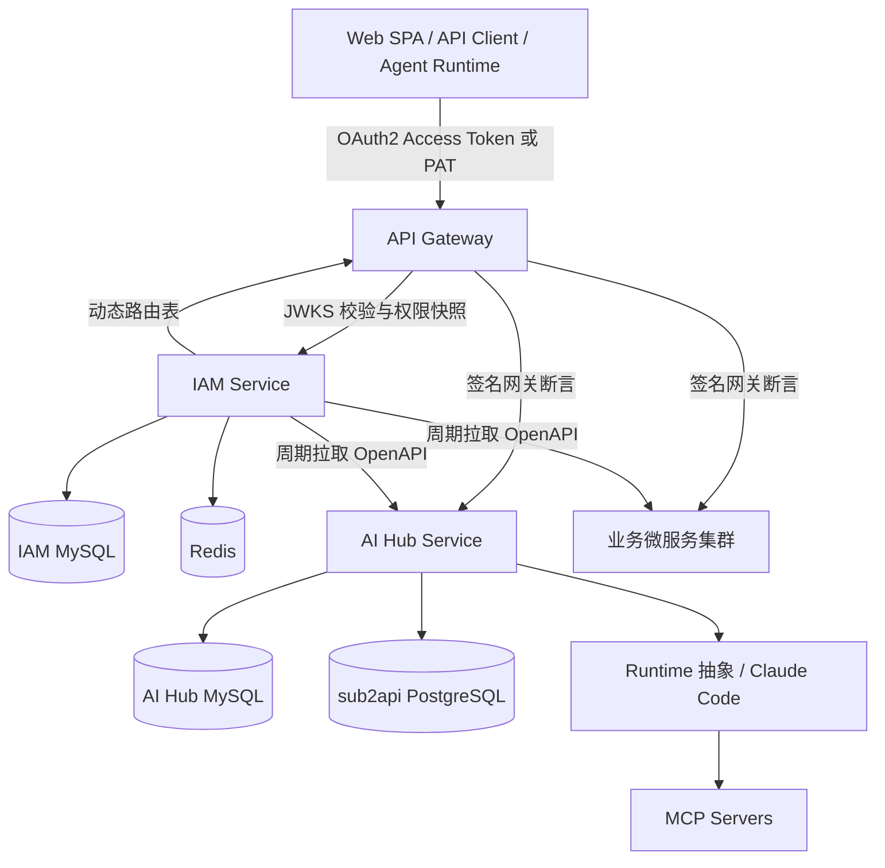
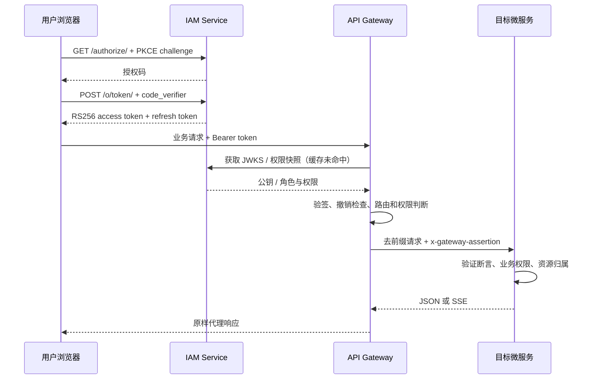
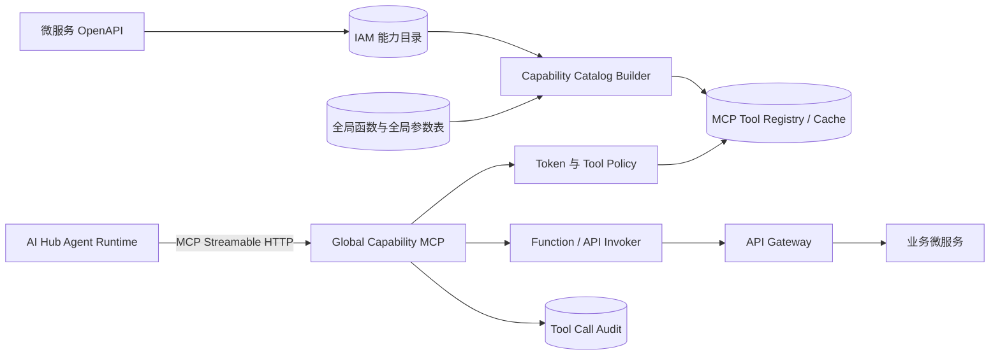
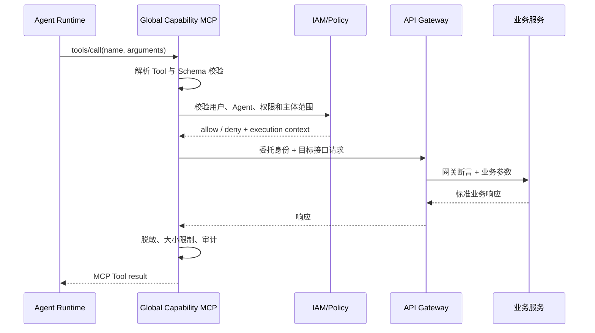
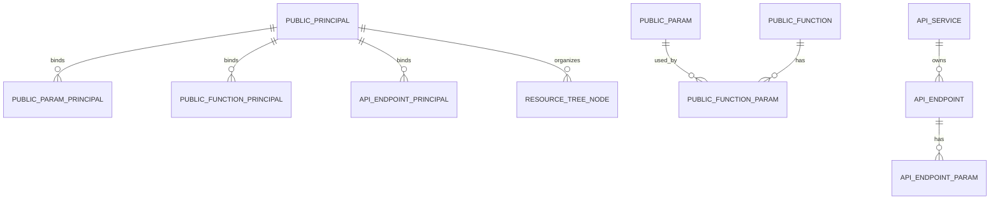
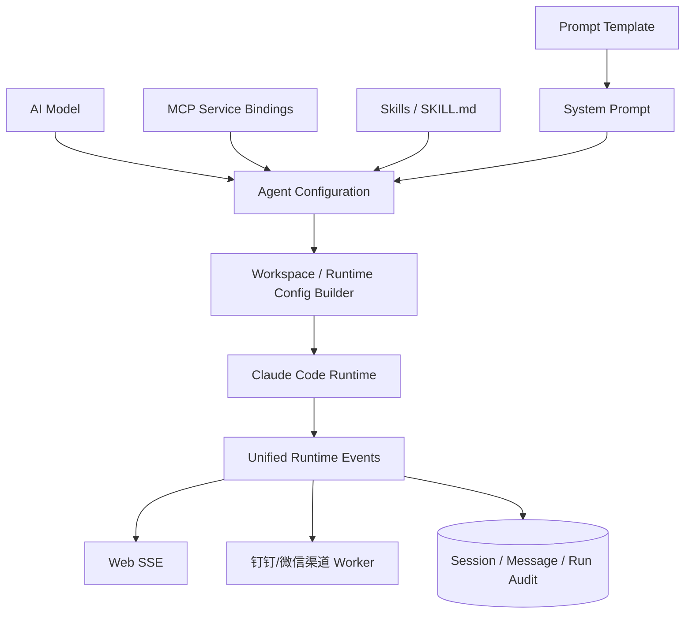
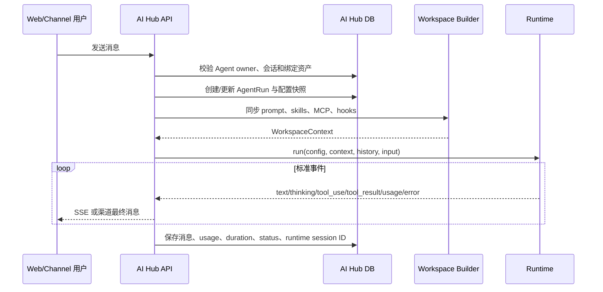

# AI Hub 云智能体平台需求与架构设计

> 文档性质：基于现有代码的逆向需求设计与目标态方案  
> 代码范围：`D:\git_repo\service\api-gateway`、`D:\git_repo\service\iam-service`、`D:\git_repo\aihub`  
> 版本：V1.0  
> 日期：2026-07-27  
> 状态：评审稿

## 0. 文档说明

### 0.1 编写目的

本文从 API Gateway、IAM Service 与 AI Hub 三套现有代码反向提炼业务需求和架构约束，并针对尚未落地的“接口与全局函数统一 MCP 暴露”补充目标态设计。文档用于产品、架构、研发、测试、安全和运维共同评审，也可作为后续拆分 PRD、接口设计和实施任务的基线。

### 0.2 事实口径

| 标记 | 含义 |
|---|---|
| 已实现 | 能在当前代码、数据模型或前端页面中找到直接证据 |
| 待完善 | 已有局部实现，但契约、安全边界或运维能力不完整 |
| 新增 | 为满足本次目标必须新增的能力 |

### 0.3 范围与非范围

本期范围包括统一网关与身份体系、微服务发现和路由、MCP 能力目录与调用、主体对象资产看板、云智能体装配与运行。业务微服务自身的领域逻辑、模型供应商计费规则、基础模型训练和外部 IM 平台协议实现不在本文展开。

### 0.4 结论摘要

| 主题 | 当前基线 | 目标态与主要差距 |
|---|---|---|
| 微服务架构 | 网关从 IAM 动态拉取接口级路由；IAM 提供 OAuth2 PKCE、RBAC、服务发现；AI Hub 承载 AI 资产与 Agent 运行 | 统一所有微服务的签名网关断言校验，取消对可伪造身份头的单独信任；未注册接口按默认拒绝治理 |
| MCP 服务 | AI Hub 已能登记、加密存储、绑定并注入外部 MCP 配置，但没有“全局能力 MCP Server” | 新增统一 MCP 服务，将 IAM 发现的接口和已发布规范全局函数转换为可调用 Tool，并补齐完整 Schema、执行绑定、权限和审计 |
| 主体对象看板 | 已有主体、全局参数、全局函数、接口三类资产的统计、绑定、详情与五级树 | 增加数据质量、暴露状态、调用健康和影响分析，使看板同时成为治理入口和 MCP 发布前置检查 |
| 云智能体 | 模型、MCP、技能、系统提示词可装配到 Agent；支持 Claude Code Runtime，保留其他运行时扩展接口 | 明确配置优先级、版本快照、能力最小授权、Secret 生命周期、运行审计和发布流程 |

## 1. 微服务架构设计（网关 + 身份 + 微服务）

### 1.1 设计目标

1. 客户端只通过统一网关访问业务 API，业务服务不直接暴露到公网。
2. IAM 是身份、角色、权限、服务目录和接口目录的唯一权威来源。
3. 网关负责认证、粗粒度授权、路由、限流、熔断和观测；微服务负责业务授权和资源归属校验。
4. 微服务通过 OpenAPI 被自动发现，路由和参数元数据不在网关硬编码。
5. 用户身份在服务间采用短时、请求绑定、可验签的网关断言传递。

### 1.2 总体架构



### 1.3 组件职责

| 组件 | 核心职责 | 不承担的职责 |
|---|---|---|
| API Gateway | 路由、JWT 验证、权限前置检查、网关断言、限流、熔断、代理、SSE 透传、指标 | 用户和角色主数据管理；业务资源归属判断 |
| IAM Service | OAuth2/OIDC 风格授权、PKCE、PAT、JWT/JWKS、RBAC、服务目录、接口发现、主体对象元数据 | AI 资产内容管理；Agent 执行 |
| AI Hub | Skill、MCP 配置、模型、提示词、Agent、会话、运行、渠道、用量看板 | 用户密码验证；网关路由决策 |
| 业务微服务 | 领域业务、OpenAPI 契约、业务数据、幂等和事务 | 统一登录；跨服务路由表维护 |
| Redis | 权限快照、Token 撤销、同步分布式锁、网关运行缓存 | 权威业务数据持久化 |

### 1.4 请求主链路



### 1.5 网关功能需求

| 编号 | 需求 | 验收口径 |
|---|---|---|
| MS-GW-01 | 网关必须从 IAM 的 `GET /api/gateway/routes` 获取动态路由 | 服务新增接口无需修改网关代码；刷新周期默认 60 秒 |
| MS-GW-02 | 路由按最长路径优先，并兼容配置的前缀别名 | `/warehouse-service/*` 可映射到规范前缀 `/inventory/*`，且不覆盖已存在规范前缀 |
| MS-GW-03 | 支持 GET、HEAD、POST、PUT、DELETE、PATCH、OPTIONS | HEAD 可继承对应 GET 规则 |
| MS-GW-04 | 认证接口必须校验 RS256 JWT 的 issuer、audience、期限、jti、token_type 和撤销状态 | 无效、过期、撤销或 audience 不匹配返回 401；撤销状态不可用时返回 503 |
| MS-GW-05 | 网关按接口方法检查 IAM 下发的 permission code | 非超级管理员缺少权限时返回 403 |
| MS-GW-06 | 网关向上游签发 30 秒以内的请求绑定断言 | 断言包含 `iss/aud/sub/jti/method/path/query/roles/permissions`，篡改方法、路径或查询即失效 |
| MS-GW-07 | 客户端传入的 `x-user-*` 和 `x-gateway-assertion` 必须在代理前清除 | 上游只能收到网关重建的可信身份信息 |
| MS-GW-08 | SSE/流式响应必须边读边转发 | Agent 长连接不被整包缓存，保留 `text/event-stream` |
| MS-GW-09 | 网关提供限流、熔断、健康和指标 | `/gateway/health` 可看到路由加载时间、路由数、服务数和错误数 |
| MS-GW-10 | 未匹配精确端点但命中服务前缀时必须执行安全兜底 | 目标态默认要求上游再次认证；生产环境禁止“未知接口匿名放行” |

### 1.6 IAM 功能需求

#### 1.6.1 身份与 Token

| 编号 | 需求 |
|---|---|
| MS-IAM-01 | SPA 使用 Authorization Code + PKCE S256，不向浏览器分发 client secret |
| MS-IAM-02 | 授权码必须短期、单次使用，并绑定 client、redirect URI 和 code challenge |
| MS-IAM-03 | Access Token 使用 RS256，公钥通过 `/.well-known/jwks.json` 发布并支持 `kid` 轮换 |
| MS-IAM-04 | Refresh Token 使用 rotation 与 reuse detection；发现重复使用时撤销整个 token family |
| MS-IAM-05 | PAT 使用独立的 `token_type=pat`，MCP 场景 audience 为 `mcp-server`，可撤销、可过期、只显示一次明文 |
| MS-IAM-06 | HS256 仅作为有截止时间的兼容通道，不得从旧 Token 的角色声明直接授权 |

#### 1.6.2 RBAC

权限采用 `system:module:action` 或现有兼容格式，支持 `fnmatch` 风格通配。网关做接口权限前置判断，服务端仍需做同等或更细的授权，尤其是 `current_user.user_id` 资源归属过滤。

```text
User -> UserRole -> Role -> RolePermission -> Permission
                                     |
                                     +-> system/module/action/resource metadata
```

#### 1.6.3 服务与接口发现

| 编号 | 需求 | 当前实现依据 |
|---|---|---|
| MS-DISC-01 | IAM 管理服务名称、base URL、path prefix、启用状态 | `api_service` |
| MS-DISC-02 | 周期并发拉取启用服务的 `/openapi.json` | `EndpointSyncScheduler` + `EndpointDiscoverer` |
| MS-DISC-03 | 以 `(service_id, method, path)` 幂等 upsert 接口 | `api_endpoint` 唯一约束 |
| MS-DISC-04 | OpenAPI 中消失的接口软删除，重新出现时恢复 | `is_deleted` 与 reactivated 统计 |
| MS-DISC-05 | 同步接口的 summary、description、tags、security 和入出参层级 | `api_endpoint`、`api_endpoint_param` |
| MS-DISC-06 | 使用 Redis 锁避免多实例重复同步 | `iam:endpoint-sync:lock`，锁 TTL 和同步周期可配置 |
| MS-DISC-07 | 目标态需要保存每个 Operation 的完整 JSON Schema 快照 | 当前只保存名称、父级、必填、方向和顺序，无法生成严格 MCP Tool Schema |

### 1.7 路由契约

IAM 下发的单条路由至少包含：

```json
{
  "path_pattern": "/aihub/api/skills",
  "methods": ["GET", "POST"],
  "target": "http://aihub:8000",
  "auth_required": true,
  "strip_prefix": "/aihub",
  "permission_map": {
    "GET": "aihub:skill:view",
    "POST": "aihub:skill:create"
  }
}
```

路由表替换必须是原子的；刷新失败时继续使用上一版，不得把有效路由表清空。服务下线应先在 IAM 禁用，再等待网关刷新，最后停止实例。

### 1.8 服务身份与信任边界

当前 IAM 已验证 `x-gateway-assertion`，而 AI Hub `backend/auth.py` 仍直接读取 `x-user-*`。同时，网关断言包含角色和权限，但兼容身份头没有完整注入这些字段。因此目标态必须执行以下收敛：

1. AI Hub 和所有业务服务统一验证 `x-gateway-assertion`，校验 audience、method、path、query、exp 和 jti。
2. `x-user-*` 只保留为迁移期兼容字段，不得在缺少有效断言时独立建立身份。
3. 网关到微服务网络仅允许内网访问，并由网络策略阻止客户端绕过网关直连。
4. 网关断言密钥不得与 OAuth Token 签名密钥复用；推荐后续升级为非对称服务身份或 mTLS。
5. 网关路由获取接口应限制为内网或服务凭据访问，避免外部枚举内部拓扑。

### 1.9 非功能需求

| 维度 | 目标 |
|---|---|
| 可用性 | 网关和 IAM 支持多实例；路由刷新失败不影响已加载规则；关键缓存失败采用明确 fail-closed 策略 |
| 性能 | 网关自身增加的 P95 延迟不超过 30 ms（不含权限缓存未命中）；普通代理不缓冲请求/响应正文 |
| 扩展性 | 新增服务只需登记服务并提供 OpenAPI；新增 Runtime 通过统一抽象注册 |
| 可观测性 | 全链路携带 request ID、user ID、service、endpoint ID、status、latency；不记录 Token、Secret 和完整提示词 |
| 配置安全 | 数据库、Redis、签名密钥和加密主密钥通过 Secret 管理，不写入仓库和日志 |
| 兼容性 | 前缀别名、旧 Token 和旧身份头均必须有明确移除日期、指标和告警 |

## 2. MCP 服务设计（接口 + 全局函数全暴露）

### 2.1 现状判断

AI Hub 当前的 `mcp_services` 是“外部 MCP 连接配置目录”，支持 `stdio`、`sse/http/streamable_http` 和原始 JSON 配置，能够按用户管理、加密保存、绑定 Agent，并转换为 Claude Code `.mcp.json`。这不等于平台已经实现一个对外提供 `tools/list` 和 `tools/call` 的 MCP Server。

本章新增“Global Capability MCP Service”。它将 IAM 的接口目录、主体对象元数据和全局函数目录转换为 MCP Tools，并作为一个普通 MCP 服务登记到 AI Hub，供 Agent 选择绑定。

### 2.2 目标与原则

1. 所有满足发布门槛的全局函数必须可发现、可调用。
2. 所有启用且允许 MCP 暴露的 API 接口必须可发现、可调用。
3. “全暴露”指能力目录完整，不代表绕过权限；调用者实际可见集合必须经过用户、Agent、主体和接口权限过滤。
4. Tool 名称、输入输出 Schema 和执行目标必须稳定、可版本化、可追踪。
5. 危险副作用能力默认需要明确策略，不能因绑定 MCP 就获得平台级无限权限。

### 2.3 总体架构



### 2.4 暴露范围

#### 2.4.1 全局函数

全局函数纳入条件与现有主体看板保持一致：

```text
PublicFunction.type = 3
AND PublicFunction.status = 3
AND PublicFunction.is_standardized = 1
```

每个函数还必须具备唯一 `function_code`、至少一个主体绑定、完整入出参定义、执行绑定和权限策略。历史数据不满足条件时进入“待治理清单”，不得以不可调用 Tool 混入生产目录。

#### 2.4.2 API 接口

接口纳入条件：服务 `is_active=true`、接口 `is_deleted=false`、`mcp_exposure != disabled`、具有可解析 Operation Schema。接口的 `auth_required` 和 permission map 原样进入 Tool Policy。

#### 2.4.3 去重与命名

当全局函数映射到某个 API 接口时，两者仍可分别暴露，以满足“函数语义入口”和“原始接口入口”的完整性；目录必须通过 `canonical_resource_id` 标识它们指向同一执行能力，供客户端去重展示。

| 来源 | Tool 名称规则 | 示例 |
|---|---|---|
| 全局函数 | `fn__{function_code}` | `fn__SKU_QUERY` |
| API 接口 | `api__{service_code}__{method}__{normalized_path}` | `api__product__get__api_products_id` |

名称仅允许字母、数字和下划线，长度不超过 64；发生冲突时追加稳定资源 ID，禁止使用随描述变化的随机后缀。

### 2.5 MCP 协议接口

生产传输首选 Streamable HTTP，统一入口建议为 `/mcp-global/mcp`，经网关访问。兼容期可保留 SSE，但不新增 stdio 作为跨服务生产入口。

| MCP 方法 | 需求 |
|---|---|
| `initialize` | 返回协议版本、server name/version、capabilities；校验客户端 Token 和 audience |
| `notifications/initialized` | 建立会话后确认，不产生业务副作用 |
| `tools/list` | 返回当前调用者有权查看的全部 Tool；支持 cursor，跨页合集必须覆盖全部授权能力 |
| `tools/call` | 校验 Tool、JSON Schema、权限、幂等策略和超时后调用执行器 |
| `ping` | 返回服务存活状态，不访问业务系统 |

HTTP 层要求：

- `Authorization: Bearer <PAT/access_token>`，PAT audience 必须包含 `mcp-server`。
- 通过网关时使用用户身份断言；服务到服务调用使用短期委托 Token，不转发模型供应商 Key。
- 单次调用默认超时 30 秒，可按 Tool 配置但不得超过平台上限。
- 响应和错误遵循 MCP JSON-RPC；业务错误放在 Tool result 的结构化错误内容中，协议错误使用标准 JSON-RPC error。

### 2.6 Tool 描述模型

每个 Tool 目录项至少包含：

| 字段 | 来源或规则 |
|---|---|
| `name` | 稳定命名规则 |
| `title` | 函数描述或接口 summary |
| `description` | 业务详细说明、主体对象、读写语义、权限提示 |
| `inputSchema` | 全局参数树或 OpenAPI request schema |
| `outputSchema` | 全局函数标准响应或 OpenAPI 2xx response schema |
| `annotations.readOnlyHint` | GET/HEAD 或显式只读函数为 true |
| `annotations.destructiveHint` | DELETE、不可逆更新或策略标记为 true |
| `annotations.idempotentHint` | GET/PUT 或显式幂等函数为 true |
| `annotations.openWorldHint` | 调用外部系统、网络或非平台数据时为 true |
| `resource_type/resource_id` | `function`/`endpoint` 及源记录 ID，用于审计 |
| `principal_ids` | 关联主体对象集合 |
| `schema_version` | Schema 内容哈希或递增版本 |

### 2.7 Schema 生成规则

#### 2.7.1 全局函数 Schema

`t_public_function_param.type=1` 生成输入，`type=2` 生成业务输出。参数定义来自 `t_public_params`：`param_name` 为字段名、`param_desc` 为标题、`param_detail` 为描述、`data_type` 映射 JSON Schema 类型、`required` 进入 required 数组、`example` 进入 examples。

`child_id` 表示复合参数子项。构建器必须循环检测，递归深度与看板保持最多 5 层；File 类型作为叶子，不继续展开。全局函数输出统一包装为：

```json
{
  "type": "object",
  "required": ["code", "msg", "data"],
  "properties": {
    "code": {"type": "integer"},
    "msg": {"type": "string"},
    "data": {"type": "object"}
  }
}
```

#### 2.7.2 API Schema

当前 `api_endpoint_param` 只足以支撑看板展示，不足以表达 enum、format、数组 item、组合类型、additionalProperties 和多媒体。因此新增持久化结构：

| 表/字段 | 用途 |
|---|---|
| `api_endpoint_schema.endpoint_id` | 关联接口 |
| `operation_json` | 解析并裁剪后的 OpenAPI Operation |
| `input_schema_json` | 完整请求 JSON Schema |
| `output_schema_json` | 选定 2xx 响应 JSON Schema |
| `schema_hash` | 变更检测与缓存失效 |
| `synced_at` | 同步时间 |

Schema 必须解析本地 `$ref`，保留必要定义并限制最大大小和递归深度。发现破损 Schema 时保留上一版可用目录并产生告警。

### 2.8 执行绑定

全局函数现有表描述“是什么”，但没有足够信息决定“调用哪里”。因此新增执行绑定是全量暴露的硬前置条件。

| 字段 | 说明 |
|---|---|
| `function_id` | 全局函数 ID，唯一 |
| `binding_type` | `endpoint`、`workflow` 或 `internal` |
| `endpoint_id` | HTTP 执行时关联 IAM 接口 |
| `target_ref` | 工作流/内部处理器稳定标识 |
| `timeout_seconds` | 调用超时 |
| `idempotency_mode` | `none`、`caller_key`、`server_generated` |
| `enabled` | 是否允许执行 |
| `version` | 乐观锁和发布版本 |

发布校验必须保证每个符合条件的全局函数都有启用的执行绑定，且绑定接口仍然存在、参数映射完整。

### 2.9 调用流程



### 2.10 权限、安全与审计

| 编号 | 需求 |
|---|---|
| MCP-SEC-01 | `tools/list` 和 `tools/call` 使用同一策略计算，防止“不可见但可猜名调用” |
| MCP-SEC-02 | 权限由接口 permission code、函数 policy、Agent 绑定范围和用户身份共同求交集 |
| MCP-SEC-03 | 写入、删除、产生费用或敏感数据 Tool 标记风险等级；Agent Runtime 按策略触发用户确认 |
| MCP-SEC-04 | MCP Server 不保存或转发模型 API Key；上游凭据使用受控 Secret 或短期委托 Token |
| MCP-SEC-05 | URL、Header、响应和错误统一脱敏，禁止 SSRF 到环回、链路本地和未授权网段 |
| MCP-SEC-06 | 每次调用记录 run ID、tool、源资源 ID、用户、Agent、耗时、结果码和策略决策，不记录 Secret 与完整敏感正文 |
| MCP-SEC-07 | Tool 输出设单项和总大小上限；超限返回摘要和受控资源引用，不直接填满模型上下文 |
| MCP-SEC-08 | 对幂等 Tool 可进行有限重试；具有副作用且幂等性未知的 Tool 禁止自动重放 |

### 2.11 管理接口

除 MCP 协议外，需要管理面 REST API：

| 方法与路径 | 用途 |
|---|---|
| `GET /api/mcp-capabilities/summary` | 接口、函数、可发布、阻断、Schema 异常统计 |
| `GET /api/mcp-capabilities/tools` | 管理员检索 Tool 目录及来源 |
| `POST /api/mcp-capabilities/rebuild` | 触发目录重建，要求管理权限和分布式锁 |
| `POST /api/mcp-capabilities/validate` | 发布前全量校验，不产生调用 |
| `GET/PUT /api/global-functions/{id}/execution-binding` | 查看或维护执行绑定 |
| `GET /api/mcp-capabilities/calls` | 审计查询 |

### 2.12 验收标准

1. 任意已发布、已规范且具有有效绑定的全局函数都能在授权用户的 `tools/list` 全量分页结果中找到并成功调用。
2. 任意启用且允许 MCP 暴露的接口都能生成稳定 Tool，OpenAPI Schema 变更后目录版本更新。
3. 无权限用户既看不到 Tool，也无法通过名称直接调用。
4. 入参缺失、类型错误、上游 4xx/5xx、超时和断路均返回可定位但不泄密的结构化错误。
5. Agent 解绑该 MCP 后，下一次工作区/Runtime 同步不再具备这些 Tool。
6. 全量目录、调用结果和审计记录之间可通过 `resource_type/resource_id/schema_version/run_id` 追踪。

## 3. 主体对象看板设计（全局函数、全局参数、接口）

### 3.1 产品定位

主体对象是业务资产的组织根，例如 SKU、订单、供应商。看板不是单纯统计页，而是围绕主体统一回答四个问题：有哪些标准数据、有哪些业务能力、有哪些对外接口、这些资产彼此如何关联并由谁负责。

### 3.2 数据关系



| 资源 | 权威表 | 有效口径 |
|---|---|---|
| 主体对象 | `t_public_principal` | 全部主体；`type=1` 为重点主体 |
| 全局参数 | `t_public_params` | 通过 `t_public_params_principal` 与主体绑定 |
| 全局函数 | `t_public_function` | `type=3 AND status=3 AND is_standardized=1` |
| API 接口 | `api_endpoint` | `is_deleted=false`，通过 `api_endpoint_principal` 与主体绑定 |

### 3.3 看板总览

总览提供四个全局指标：主体对象总数、全局参数总数、有效全局函数总数、未删除接口总数。搜索和“重点/全部”筛选只影响列表，不改变全局指标。

主体列表每项展示中英文名、是否重点、参数数、函数数和接口数。重点主体使用卡片视图，全部主体使用表格视图；点击资源数进入对应详情页。

### 3.4 资源页

| 资源类型 | 平铺视图 | 树视图 | 特有视图 |
|---|---|---|---|
| 全局参数 | 标签/检索 | 五级分组树 | 关联函数与接口状态 |
| 全局函数 | 标签/检索 | 五级分组树 | 输入、标准输出、责任人 |
| API 接口 | 标签/检索 | 五级分组树 | 按微服务分组，显示 method/path |

通用要求：

- 默认只展示已绑定到当前主体的资源。
- 管理绑定时可检索全部候选资源并批量替换绑定。
- 参数支持按名称、中文描述或参数编码精确批量匹配，返回匹配项和未匹配值。
- 树节点分为 `group` 与 `resource`，支持标签、备注、排序和拖拽；最大 5 级。
- 同一资源可以出现在不同父节点下，但同一父节点下不得重复。
- 保存树前必须验证资源存在，并自动补齐当前主体绑定；跨主体资源不得静默串入。

### 3.5 详情模型

#### 3.5.1 全局参数详情

展示参数编码、英文名、中文名、详细说明、数据类型、状态、创建/申请/发布人、子参数树、关联全局函数和关联接口。

现有关系分析只把“输出参数”视为数据产出关系：全局函数 `type=2`、接口参数 `type=2`。请求入参不计入“该参数由哪些能力产出”的关联列表。目标态可另增“作为输入被消费”视图，但必须与“被产出”分开统计。

#### 3.5.2 全局函数详情

展示函数编码、名称、描述、状态、规范化状态、提交人、开发人、测试人、输入参数树和标准响应 `code/msg/data`。子参数递归最多 5 层，循环引用必须停止，File 类型为叶子。

#### 3.5.3 接口详情

展示所属服务、method、path、summary、description、tags、是否认证、绑定权限、产品经理、开发、测试、输入参数树和输出参数树。接口参数首先按 OpenAPI `parent_name` 还原结构，再以全局参数元数据补齐中文名、类型和描述。

### 3.6 API 契约

| 方法与路径 | 作用 | 权限 |
|---|---|---|
| `GET /api/dashboard/principals` | 总览指标和主体分页 | 超级管理员 |
| `GET /api/principals/{id}/resources/{type}` | 参数/函数/接口列表 | 超级管理员 |
| `GET /api/principals/{id}/resources/{type}/detail/{resource_id}` | 资源详情 | 超级管理员 |
| `GET /api/principals/{id}/resources/{type}/bindings` | 获取绑定 ID | 超级管理员 |
| `PUT /api/principals/{id}/resources/{type}/bindings` | 原子替换绑定 | 超级管理员 |
| `POST /api/principals/{id}/resources/params/batch-match` | 参数批量精确匹配 | 超级管理员 |
| `GET /api/principals/{id}/resources/{type}/tree` | 获取资源树 | 超级管理员 |
| `PUT /api/principals/{id}/resources/{type}/tree` | 替换资源树 | 超级管理员 |
| `PUT /api/endpoints/{endpoint_id}/owners` | 更新接口三类负责人 | 超级管理员 |

列表统一支持 `search`、`bound_only`、`skip`、`limit`；接口额外支持 `service_id`；参数额外支持状态筛选。页面需要全量数据时显式传 `paginate=false`，普通管理列表继续分页。

### 3.7 治理增强需求

为支撑 MCP 全量发布，在现有看板增加以下状态：

| 状态 | 说明 |
|---|---|
| Schema 完整度 | 参数类型、必填、子项、描述、示例是否满足 Tool 生成 |
| 执行就绪 | 全局函数是否有有效 execution binding |
| MCP 暴露状态 | disabled、candidate、published、blocked |
| 权限完整度 | 是否绑定 permission/policy，危险操作是否标注 |
| 健康状态 | 最近一次目录构建、探测和真实调用结果 |
| 责任完整度 | 产品、开发、测试负责人是否齐全 |

看板应提供“阻断原因”筛选和跳转修复入口；不得仅显示一个笼统红色状态而无法定位缺失字段。

### 3.8 性能与一致性

1. 总览统计使用聚合查询，避免按主体 N+1 查询。
2. 资源详情批量预取参数和用户显示名；参数递归在应用层做循环与深度保护。
3. 绑定替换和树替换必须在单个事务内完成，失败全部回滚。
4. OpenAPI 同步软删除接口时保留主体绑定历史和审计，但默认不在看板有效数中展示。
5. 大于 500 条的批量操作必须拆分或异步化，并提供进度和失败明细。

### 3.9 验收标准

1. 总览统计口径与数据库有效条件一致，搜索不改变总量。
2. 三类资源均可完成检索、详情、绑定、树组织和刷新。
3. 五级树合法保存，第六级、空分组名、无资源 ID、跨主体非法资源均被拒绝。
4. 函数和接口的入出参顺序、必填和层级与源定义一致，循环引用不会导致请求失控。
5. 参数“产出关联”只计算输出参数；若增加“输入消费”必须单列。
6. MCP 阻断项可从看板定位到具体函数、接口或参数并给出修复原因。

## 4. 云智能体整体架构设计（模型、MCP、技能、提示词）

### 4.1 设计目标

云智能体是四类可复用资产的受控装配体：模型提供推理，MCP 提供外部工具，Skill 提供领域方法和文件，提示词定义身份与行为。Agent 负责选择、约束和版本化这些资产，Runtime 负责在隔离环境中执行。

### 4.2 总体架构



### 4.3 四类核心资产

| 资产 | 当前模型 | 关键需求 |
|---|---|---|
| 模型 | `ai_models` | 用户隔离；模型名、provider、API protocol、proxy URL、reasoning 能力；API Key 加密；Runtime 兼容校验 |
| MCP | `mcp_services` + `agent_mcps` | 连接模板与 Secret 分离；Agent 只加载已绑定 MCP；支持 env/header 覆盖并加密；公开页只返回脱敏模板 |
| 技能 | `skills` + `skill_releases` + `agent_skills` | SKILL.md 文件树、导入、编辑、版本发布、Git 同步、公开分享；运行时安装到独立 Agent 工作区 |
| 提示词 | `prompt_templates` + `agents.system_prompt` | 模板用于创作和复用，运行时以 Agent 的 system prompt 为准；变量展开必须在保存或运行前校验 |

提示词模板当前不是 Agent 的持久化外键绑定。前端选择模板后应把解析结果写入 `system_prompt`，或者目标态新增 `prompt_template_id + rendered_prompt + template_version`，避免把“模板选择”误认为已存在的运行时关系。

### 4.4 Agent 配置模型

Agent 至少包含：名称、描述、图标、系统提示词、Runtime 类型、默认模型、可选模型集合、Skill 集合、MCP 集合、MCP 覆盖、思考强度、推理可见性、最大轮次、超时、公开状态和 owner user ID。

约束如下：

1. 默认模型必须同时属于 Agent 的模型集合。
2. Claude Code 只接受 `anthropic-messages`；新运行时须单独声明兼容协议。
3. 所有绑定资产必须属于当前用户，或是明确允许复制/使用的公开模板；不能通过 ID 猜测绑定他人私有资产。
4. MCP 覆盖按 transport 限制字段：stdio 允许 env，HTTP/SSE 允许 headers；空值表示删除继承项。
5. MCP 覆盖和模型 Key 使用带 purpose/AAD 的加密信封，禁止明文出现在 API、工作区、日志和运行快照。

### 4.5 配置装配与优先级

从低到高的配置优先级为：平台默认值、资产定义、Agent 配置、会话固定值、单次 Run override。单次 override 只能在 Agent 已绑定集合内选择，不得临时越权加载新模型、Skill 或 MCP。

| 配置 | 平台默认 | Agent | 会话 | 单次 Run |
|---|---|---|---|---|
| Runtime | `claude_code` | 可选 | 首次执行后固定 | 仅新会话可覆盖 |
| 模型 | 无 | 默认模型 + 候选集合 | 可记录当前模型 | 只能从已绑定模型选择 |
| Skill | 全部已绑定 | 绑定集合 | 不固定 | 可选择一个已绑定 Skill 聚焦执行 |
| MCP | 无 | 绑定集合 + 加密覆盖 | 不扩大 | 不允许临时新增 |
| System Prompt | 平台规则 | Agent prompt | 继承 | 不允许客户端替换系统身份 |
| 超时/轮次 | 平台上限 | Agent 值 | 继承 | 只能在策略允许范围内收紧 |

### 4.6 Workspace 与 Runtime 映射

#### 4.6.1 Claude Code

```text
agent_workspaces/{agent_id}/
├── CLAUDE.md
├── .mcp.json
└── .claude/
    ├── settings.json
    ├── hooks/
    └── skills/{skill_name}/...
```

- `CLAUDE.md` 合并 Agent 身份、系统提示词、执行规则和已加载技能索引。
- `.mcp.json` 由已绑定 MCP 生成。
- `settings.json` 启用已绑定 MCP，并配置工具 allow/deny 和 hooks。
- 工作区以 Agent 为边界；生产优先使用独立 Linux 用户/native sandbox，禁止访问其他 Agent 工作区。

### 4.7 统一执行流程



### 4.8 统一 Runtime 事件

Runtime 适配器必须输出统一事件：`text`、`thinking`、`tool_use`、`tool_result`、`usage`、`info`、`permission_request`、`done`、`error`。Web 适配器序列化为 SSE；渠道 Worker 只取最终可见文本，不能把思考、Secret、工具原始结果或内部堆栈发送到外部渠道。

会话创建后固定 Runtime，避免同一上下文跨引擎时语义不一致。运行可取消，长任务维护 heartbeat、deadline 和 execution lease；服务异常后由 Worker 识别 `queued/running/unknown` 状态并安全收敛。

### 4.9 运行快照与可复现性

每次 Run 保存不含 Secret 的配置快照：Agent ID 与更新时间、system prompt SHA-256、Runtime、模型 ID、Skill ID/版本、MCP ID、权限模式、超时、最大轮次、思考强度和推理可见性。目标态补充 `model_config_version`、`mcp_schema_version`、`prompt_template_version` 和 `workspace_manifest_hash`。

快照用于审计和问题定位，不应保存 API Key、MCP Header/env value、Gateway Token、附件全文或完整敏感 Prompt。

### 4.10 权限和安全

| 编号 | 需求 |
|---|---|
| AG-SEC-01 | 所有 Agent、Session、Run、Skill、MCP、Model 查询按 `current_user.user_id` 过滤 |
| AG-SEC-02 | Runtime 只获得本次 Run 所需的最小 Secret，运行结束后尽快释放 |
| AG-SEC-03 | Agent 只允许调用已绑定 MCP；绑定不应自动等同于危险操作无需确认 |
| AG-SEC-04 | PreToolUse 做工作区与高风险命令拦截，PostToolUse 做输出大小和脱敏控制 |
| AG-SEC-05 | 工作区路径规范化，拒绝绝对路径、`..`、符号链接逃逸和跨 Agent 访问 |
| AG-SEC-06 | 运行单元应默认 deny egress，仅允许模型、已绑定 MCP、DNS/NTP 和观测端点 |
| AG-SEC-07 | 公开 Skill/MCP/提示词是可复用模板，不得公开实例 Secret 或私有 URL |
| AG-SEC-08 | 删除 Agent 先取消未完成 Run、停用渠道、标记 Runtime 删除，空闲后再清理工作区 |

### 4.11 非功能需求

| 维度 | 目标 |
|---|---|
| 并发 | 不同 Agent 可并行；同一渠道会话按消息顺序处理；副作用 Run 不自动整体重试 |
| 可靠性 | 运行状态持久化、heartbeat、取消和超时均可恢复；渠道使用 inbox/outbox 幂等处理 |
| 可观测性 | 记录 run、session、agent、runtime、model、tool、token、duration 和错误码 |
| 成本 | 展示个人与汇总 Token 用量，支持按时间、用户、模型和 API Key 维度分析 |
| 可维护性 | Runtime 通过 `AbstractRuntime` 扩展；Transport 与执行核心分离 |
| 用户体验 | Web 支持流式文本、思考可见性、工具调用卡片、附件、取消和工作区浏览 |

### 4.12 验收标准

1. 用户可创建 Agent 并原子绑定至少一个兼容模型、多个 Skill 与多个 MCP。
2. Claude Code 通过统一 Runtime 接口产生事件，后续运行时遵循相同语义，Web 对话可流式显示并可取消。
3. 同一会话不能在两个 Runtime 之间切换；新会话可选择允许的 Runtime。
4. 未绑定模型、Skill、MCP 或他人私有资产无法通过请求参数绕过。
5. 运行快照可解释当次执行使用的非秘密配置，日志和工作区没有明文长期凭据。
6. MCP 全局能力服务作为普通 MCP 被 Agent 绑定后可使用，解绑并同步后立即消失。
7. Agent 删除、Runtime 异常、渠道重投和服务重启不会造成跨用户串话或重复副作用调用。

## 5. 数据模型变更建议

| 变更 | 所属服务 | 目的 |
|---|---|---|
| `api_endpoint_schema` | IAM | 保存完整 OpenAPI 输入/输出 Schema 和 hash |
| `api_endpoint.mcp_exposure` | IAM | 控制接口 MCP 暴露状态 |
| `global_function_execution_binding` | IAM 或函数权威系统 | 把函数定义绑定到可执行目标 |
| `mcp_tool_policy` | IAM | Tool 风险、权限、主体范围和确认策略 |
| `mcp_tool_catalog`（可选缓存表） | MCP Service | 稳定 Tool 名、版本、源资源和构建状态 |
| `mcp_tool_call_audit` | MCP Service | 调用审计、耗时、结果和 run 关联 |
| `agents.prompt_template_id/template_version`（可选） | AI Hub | 保留提示词模板来源和版本 |
| `agent_runs` 补充资产版本字段 | AI Hub | 增强运行可复现性 |

跨服务表不建立数据库外键；使用稳定 ID、版本和异步校验维持一致性。权威数据仍由原服务拥有，MCP 目录是可重建投影。

## 6. 实施路线

### 6.1 阶段一：安全基线与契约收敛

1. AI Hub 接入网关断言验签，补齐网关身份字段迁移与直连阻断。
2. 固化路由、OAuth、RBAC、OpenAPI 同步和主体看板 API 契约。
3. 盘点全局函数、参数、接口的数据质量与 owner。
4. 为 API Schema 和全局函数执行绑定完成数据库迁移设计。

### 6.2 阶段二：MCP 能力目录

1. 持久化完整 Operation Schema。
2. 实现全局函数与 API Tool Builder、稳定命名和发布校验。
3. 建立执行绑定、Tool Policy、目录缓存和管理 API。
4. 在主体看板增加 MCP 就绪度和阻断原因。

### 6.3 阶段三：MCP 调用与 Agent 集成

1. 实现 Streamable HTTP MCP 的 initialize、tools/list、tools/call 和 ping。
2. 通过网关调用接口，完成权限、委托身份、幂等、超时、脱敏与审计。
3. 将该 MCP 登记到 AI Hub，验证 Claude Code Runtime。
4. 增加目录规模、Schema 变更、无权限、危险调用和上游故障测试。

### 6.4 阶段四：运营与治理

1. 建设 MCP 健康、调用成功率、P95 延迟、拒绝率和错误分布看板。
2. 引入发布审批、版本回滚、弃用期和变更通知。
3. 根据使用数据优化主体范围、Tool 描述和 Agent 默认能力集。

## 7. 关键风险与决策

| 风险/决策 | 影响 | 处理意见 |
|---|---|---|
| 全量 Tool 数量过大 | 模型上下文、发现延迟和选工具准确率下降 | 服务目录保持全量；按权限和 Agent 主体范围返回授权子集，支持 cursor 和缓存 |
| 全局函数缺少执行地址 | 能列出但不能调用 | execution binding 作为发布硬门槛，历史函数先治理后上线 |
| IAM 仅保存扁平参数 | 无法生成严格 Tool Schema | 保存完整、裁剪后的 OpenAPI Schema 快照 |
| 绑定 MCP 即完全授权 | 提示注入可能触发高风险工具 | 将“可见、可调用、需确认”拆成三层策略 |
| 业务服务信任裸身份头 | 绕过网关可伪造用户 | 全服务强制验证请求绑定断言并实施网络隔离 |
| 同一能力函数/接口重复 | 模型选择混乱、审计分裂 | 使用 canonical resource 关联，描述中标明语义入口与原始接口入口 |
| Schema 或函数定义变更 | Agent 行为漂移 | 版本/hash、变更审计、兼容检查和可回滚目录 |

需要评审确认的产品决策：

1. 普通用户是否允许看到主体对象看板，还是继续仅超级管理员可见。
2. Agent 默认是否绑定全局能力 MCP，还是由 owner 主动绑定。
3. 全局函数执行绑定的权威数据归 IAM、函数管理系统还是独立 MCP 服务。
4. 危险 Tool 的确认策略由 Agent、Tool Policy 还是组织策略最终裁决；建议取三者最严格值。

## 8. 代码追溯索引

### 8.1 API Gateway

| 文件 | 证据 |
|---|---|
| `app/main.py` | MiddlewareChain、健康/指标、catch-all 路由 |
| `app/config.py` | IAM 地址、JWT、Redis、前缀别名、静态路由、限流和熔断配置 |
| `app/proxy/route_table.py` | 动态路由、最长匹配、别名和服务级 fallback |
| `app/middleware/auth_middleware.py` | RS256/JWKS、撤销检查、权限快照和网关断言 |
| `app/proxy/handler.py` | HTTP/SSE 代理与文档路径重写 |

### 8.2 IAM Service

| 文件 | 证据 |
|---|---|
| `app/api/oauth2.py` | PKCE 授权码、Token 签发、刷新和 introspection |
| `app/api/rbac.py` | 角色、权限、用户授权与缓存刷新 |
| `app/api/discovery.py` | 服务管理、接口目录、权限绑定和网关路由输出 |
| `app/services/endpoint_discoverer.py` | OpenAPI 接口及入出参发现 |
| `app/services/endpoint_sync_scheduler.py` | 周期同步、Redis 锁和状态 |
| `app/api/principal_dashboard.py` | 主体总览、三类资源、详情、绑定和五级树 |
| `app/models/principal_dashboard.py` | 全局参数、全局函数、接口参数和资源树模型 |
| `app/core/gateway_assertion.py` | 请求绑定网关断言验签 |

### 8.3 AI Hub

| 文件 | 证据 |
|---|---|
| `backend/main.py` | Skill、MCP、Model、Prompt CRUD 与公开接口 |
| `backend/models.py` | 四类资产、Agent 关系、会话、Runtime 和 Run 模型 |
| `backend/agent_routes.py` | Agent CRUD、Runtime 操作、会话、消息、SSE 和文件接口 |
| `backend/agent_service.py` | 统一执行编排、事件、运行快照、取消和持久化 |
| `backend/agent_workspace.py` | Skill/MCP/Prompt 到 Claude Code 工作区的映射 |
| `backend/runtimes/base.py` | RuntimeConfig、RuntimeEvent 与 AbstractRuntime |
| `frontend/src/views/admin/PrincipalDashboard.vue` | 主体总览交互 |
| `frontend/src/views/admin/PrincipalResourceDetail.vue` | 三类资源平铺、树和服务视图 |
| `frontend/src/views/admin/AgentDetail.vue` | 模型、MCP、Skill、提示词和 Runtime 装配页面 |

## 附录 A：术语

| 术语 | 定义 |
|---|---|
| 主体对象 Principal | 组织业务数据和能力的核心对象，如 SKU、订单、供应商 |
| 全局参数 | 跨函数和接口复用的标准数据字段，可形成复合参数树 |
| 全局函数 | 已发布、已规范的业务能力定义，不天然等于可执行 HTTP 接口 |
| API Endpoint | 从微服务 OpenAPI 发现的方法与路径 |
| MCP Tool | 模型可发现和调用的结构化工具，由函数或接口投影生成 |
| Skill | 以 SKILL.md 为入口的领域知识、步骤和配套文件集合 |
| Runtime | 执行 Agent 的引擎；当前为 Claude Code，保留扩展机制 |
| 网关断言 | 网关签发、短时、绑定请求方法/路径/查询的服务身份 JWT |

## 附录 B：总体完成定义

- 文档中“已实现”内容可由代码追溯；“新增”内容均进入实施路线。
- 网关、IAM、AI Hub、MCP 和业务服务之间的身份、权限、数据权威与故障边界明确。
- 全局函数与接口能生成完整、稳定、授权后的 MCP Tool，并通过 Agent 实际调用。
- 主体看板可解释 Tool 的来源、Schema、负责人、发布状态和阻断原因。
- Agent 的模型、MCP、Skill、提示词装配可审计、可隔离、可取消、可复现且不泄露 Secret。
